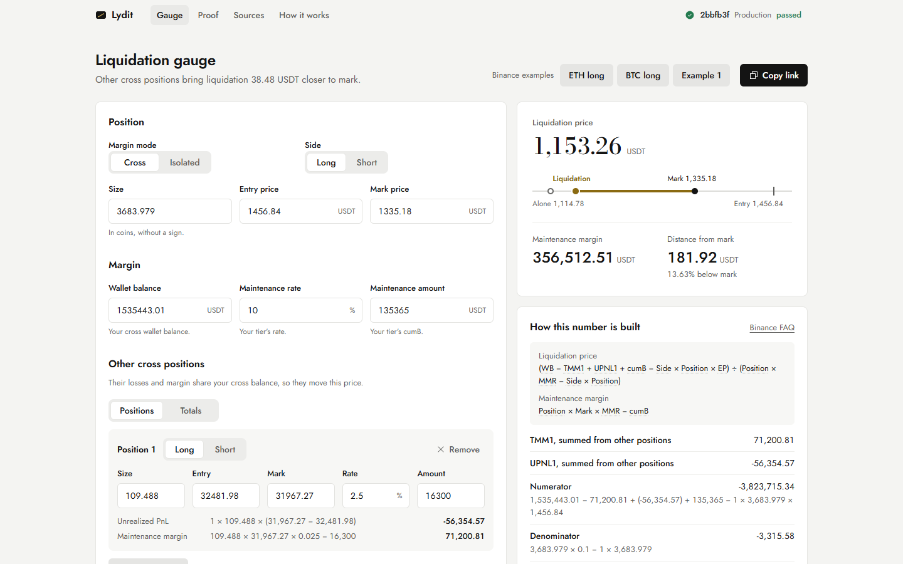
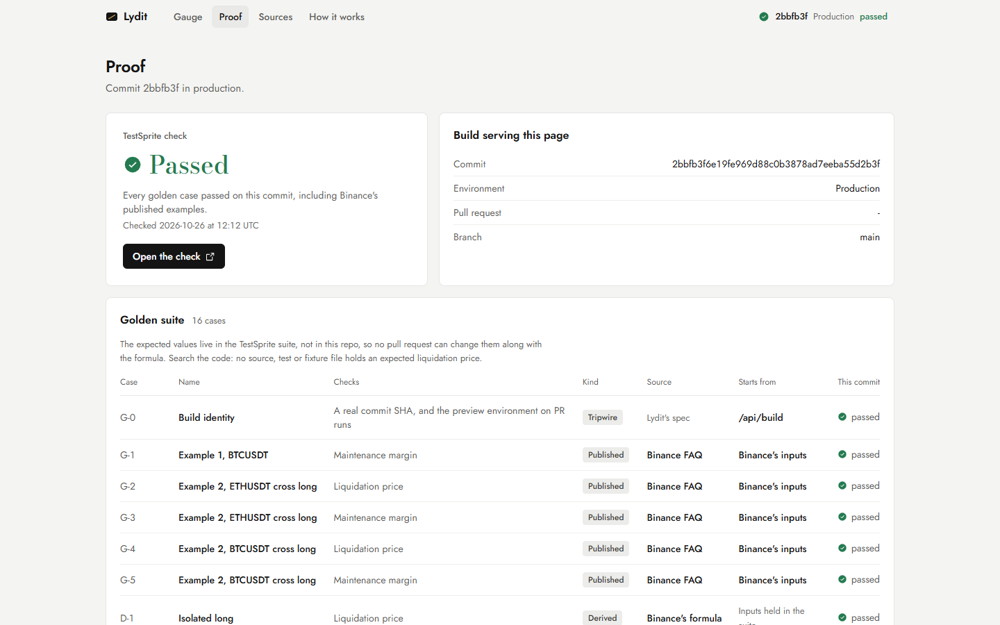

# Lydit

> *Lydite*: the black touchstone assayers streak gold across to test it before anyone trusts it.

**Lydit is a Binance USDⓈ-M liquidation gauge that counts your other cross positions.** Enter a position, see where it liquidates and how the number is built, and share it as a link. No update goes live unless it reproduces Binance's own worked examples, and the answer key lives in TestSprite, outside any pull request.

- **Live:** https://lydit.vercel.app
- **Proof for the commit you are looking at:** [/proof](https://lydit.vercel.app/proof). **Binance's published Example 2 answers (ETH 1,153.26, BTC 26,316.89) and Example 1's maintenance margin reproduce to the cent, and every page shows the TestSprite result for the exact commit it serves.**
- **The caught mistake:** [PR #2](https://github.com/Dotman-Bei/Lydit/pull/2), a refactor that dropped the other positions. TestSprite went red (16 of 35 failed, ETH showed 1,114.78), merging was blocked, the fix went green and merged.
- **TestSprite runs:** [the red run](https://www.testsprite.com/dashboard-v3/o/07da3028-9fb4-598c-bdf5-eea8b5e5f08b/projects/344af462-3655-49c8-847a-5ca8922987b1/execution/eb8e4944-5704-497f-adf8-24bdf3eefdd8) · [the green run on the fix](https://www.testsprite.com/dashboard-v3/o/07da3028-9fb4-598c-bdf5-eea8b5e5f08b/projects/344af462-3655-49c8-847a-5ca8922987b1/execution/c757267f-ea18-4e5e-a238-6afc30add5c2)
- **Formulas and every term:** [/sources](https://lydit.vercel.app/sources), from [Binance's FAQ][faq]
- **PRD:** [`prd.md`](prd.md). Design spec: [`docs/FRONTEND.md`](docs/FRONTEND.md)

| Gauge: Binance's ETH example, with the BTC position counted | Proof: the served commit and its TestSprite result |
|---|---|
|  |  |

## For judges: two minutes

Keep [Binance's FAQ][faq] open next to the gauge: its Example 2 is the reference every number below is held to.

1. Open [/gauge](https://lydit.vercel.app/gauge) and click **ETH long**. The liquidation price is **1,153.26**, the number Binance publishes for those inputs. "How this number is built" shows every term.
2. **Break it yourself.** Click **Remove** on the BTC position: the price drops to **1,114.78**, the mistake TestSprite caught in [PR #2](https://github.com/Dotman-Bei/Lydit/pull/2). Click **ETH long** again for 1,153.26.
3. **Test the logic.** Set the wallet balance to `2000000`: a long's price moves down, to **1,013.14**. Switch to **Isolated**: the BTC position stops counting, the page says so, and the price is 1,114.78. Switch to **Short**: the price jumps above entry, to **1,705.23**.
4. **Try bad input.** Type `120` in Maintenance rate or `-1` in Size: an error appears under the field and no number is shown until it is fixed.
5. **Share it.** Click **Copy link** and open it in a new tab: the same inputs and the same answer come back.
6. **Move the other position.** On the [landing page](https://lydit.vercel.app), drag the BTC mark in "Same account, two answers": as BTC falls, its loss eats the shared balance and the ETH price moves closer.
7. **Check the build you are using.** The chip at the top right shows the commit and its result. [/proof](https://lydit.vercel.app/proof) lists the 16 golden cases with their Binance sources, and **Open the check** goes to that commit's TestSprite run. Then search the code: no source, test or fixture file holds an expected liquidation price.

**Red on purpose.** [PR #2](https://github.com/Dotman-Bei/Lydit/pull/2) is a coding-agent refactor titled "compute liquidation per position". It sets the other cross positions' margin and PnL to zero, and all 19 in-repo tests still pass. On the PR's Vercel preview, TestSprite saw ETH at **1,114.78** instead of 1,153.26 and BTC at **18,778.73** instead of 26,316.89: 16 of 35 tests failed, the required check went red and GitHub blocked the merge. The fix commit restored the terms, the check went green and the PR merged. Auto-heal did not rewrite the expected numbers to fit the wrong build.

| Judging line | Where it shows |
|---|---|
| **Project quality** | The live app: a gauge for cross and isolated, long and short, with up to five other positions (or their totals), a step-by-step breakdown, a price strip, presets for Binance's examples and shareable links; a Sources page with every formula and term; a Proof page and a proof line on every screen. Checked at 1440, 768 and 390 px |
| **Tests that run themselves** | `TestSprite V3` runs 35 UI tests against every PR's Vercel preview and is a required check in the `main` ruleset (no bypass list), so a red run cannot merge. The golden cases assert one displayed number each, from Binance's published examples or labelled derivations. See [Tests that run themselves](#tests-that-run-themselves) |
| **Innovation** | The maker cannot grade its own work: the answer key sits in TestSprite, never in the PR diff, so a change can rewrite the formula but not the answers. Users see the verification status of the exact build they use, read live from GitHub |

## Why it exists

A trader in cross margin is long BTC and about to size an ETH long. A calculator that treats each position alone says ETH liquidates at **1,114.78**. Binance's own worked example for that account puts it at **1,153.26**, because the BTC position's unrealized loss and maintenance margin eat into the shared balance. The trader believes they have about $38 (3.3%) more room than they do. Lydit counts the other positions, shows the working, and is held to Binance's published numbers on every change.

## Features

| | Feature | Where |
|---|---|---|
| F1 | **Liquidation gauge**: one-way mode, cross and isolated, long and short; liquidation price, maintenance margin and distance from mark, with a "no liquidation price" state and the reason | `/gauge` |
| F2 | **Other cross positions**: up to five, each with its own unrealized PnL and maintenance margin worked inline, or their totals (TMM1, UPNL1) entered directly; isolated mode ignores them and says so | `/gauge` |
| F3 | **How this number is built**: the formula, every term with its value, the numerator and denominator, and the price the position would have alone | `/gauge` |
| F4 | **Binance presets**: ETH long, BTC long and Example 1 fill Binance's inputs only; the engine computes every output | `/gauge` |
| F5 | **Scenario links**: every input travels in the URL; copying a link and opening it restores the same inputs and outputs | "Copy link", `/sources` |
| F6 | **Validation**: field errors for empty, malformed and out-of-range input (size > 0, 0 ≤ MMR < 100%, …), no result until it is fixed | `/gauge` |
| F7 | **Proof**: the served commit, environment and branch, and its TestSprite result read from GitHub (commit status or check run, cached 60 s; a merge commit shows its pull request's result); never "passed" unless GitHub says so | `/proof`, every page, `/api/proof` |
| F8 | **Sources**: both formulas, a worked example computed by this build, every variable, the URL parameter reference with a link reader, and what is not covered | `/sources` |
| F9 | **Build identity**: `{ sha, shortSha, pr, ref, env }` for the tripwire test, and a health route | `/api/build`, `/api/health` |

## How correctness is established

1. **Binance is the source.** The formulas and both worked examples come from [Binance's FAQ][faq]: `MM = size × mark × MMR − cumB` and `LP = (WB − TMM1 + UPNL1 + cumB − Side × Position × EP) / (Position × MMR − Side × Position)`.
2. **Exact decimals.** All money math uses decimal.js at 50 significant digits, never floating point. Prices and margins are shown to 2 decimals.
3. **The answer key lives outside the repo.** Binance's published values are written into TestSprite assertion steps only. The repo holds the formula and Binance's *inputs* (as presets and links), so a pull request cannot change the formula and the expected answer together.
4. **Derived cases are labelled.** D-1 to D-5 (isolated long and short, cross short with another position, cross single position, a tier with a maintenance amount) were computed outside the repo, checked by hand, and recorded in TestSprite as "derived", not published.
5. **In-repo tests carry no answers.** They check properties of the formula (at the liquidation price, equity equals maintenance margin; more wallet balance moves a long's price down and a short's up; isolated mode ignores other positions; the "no liquidation price" states), validation messages and link round trips.

## Tests that run themselves

| Layer | What runs | When |
|---|---|---|
| **TestSprite UI** (GitHub App) | 35 tests. The 16 golden cases: G-0 build identity; G-1 to G-5 Binance's published maintenance margins and liquidation prices; D-1 to D-5 derived prices; D-6 invalid input; D-7 no liquidation; D-8 a copied link restores everything; D-9 the ETH preset; D-10 the Proof page. Plus TestSprite's generated tests for the Sources links, navigation, presets, validation and the how-it-works section | **Every push to an open PR**, against its Vercel preview; `TestSprite V3` is required by the `main` ruleset, with no bypass |
| **TestSprite exploration** | Six agents explored the live site and planned the suite | Once, on production; its first run failed 5 of 35 tests, which led to four fixes (below) |
| **Unit** (Vitest) | 19 tests: formula properties, other-position sums, validation, link round trips. No expected prices | `npm test` |
| **Proof** | Each deployment reads its own commit's TestSprite result from GitHub and shows it on every page | Every request, cached 60 s |

**What a green check means:** on that exact preview, every Binance example still reproduces to the cent, the derived cases still hold, and bad input still shows an error instead of a number.

The trigger listens for Vercel's status on commits of an open pull request. Vercel builds in under a minute, so a pull request opened after its first preview finished gets no run until its next push.

### Mistakes TestSprite caught (red, then green)

| Where | Caught by | Mistake | Fixed in |
|---|---|---|---|
| [PR #2](https://github.com/Dotman-Bei/Lydit/pull/2) | `TestSprite V3`, 16 of 35 failed | A refactor computed each position alone: ETH 1,114.78 instead of 1,153.26, BTC 18,778.73 instead of 26,316.89 | `bad1dd5` |
| Production, first run | TestSprite UI | Clearing a field from a script (value set, then an input event) was ignored by React, so the old result stayed on screen | `ab388b4`, `67fa05d` |
| Production, first run | TestSprite UI | The Sources page linked only the ETH example, not BTC or Example 1 | `87a8521` |
| Production, first run | TestSprite UI | The Proof page listed the golden cases without each one's Binance source or result | `89962f4` |
| Production, first run | TestSprite UI | How it works never mentioned the preview the check runs on | `fc4aa2d` |
| [PR #1](https://github.com/Dotman-Bei/Lydit/pull/1) | `TestSprite V3`, 34 of 35 | A generated test expected `env: production` on a PR preview; the test was corrected, not the app. The same run showed TestSprite reports a commit status, which the Proof page did not yet read | `eed3137` |

## Develop

```bash
npm install
npm run dev     # http://localhost:3000
npm test        # formula properties, validation and link round trips; no expected prices
```

| Variable | Purpose |
|---|---|
| `GITHUB_TOKEN` | Read-only token for the GitHub API (raises the rate limit). Server only |
| `NEXT_PUBLIC_REPO_URL` | Repository link shown on the site |
| `NEXT_PUBLIC_DEMO_PR_URL` | The red-then-green pull request |
| `NEXT_PUBLIC_TESTSPRITE_SUITE_URL` | The TestSprite run linked from the site |

Vercel needs "Enable access to System Environment Variables" for the proof line, and Vercel Authentication off for previews so TestSprite can reach them.

Stack: Next.js 16 (App Router, Cache Components), React 19, TypeScript, decimal.js, Vitest, Vercel, TestSprite GitHub App.

Not covered: hedge mode, portfolio margin, and venues other than Binance.

[faq]: https://www.binance.com/en/support/faq/how-to-calculate-liquidation-price-of-usd%E2%93%A2-m-futures-contracts-b3c689c1f50a44cabb3a84e663b81d93
[eth]: https://lydit.vercel.app/gauge?venue=binance&mode=cross&side=long&size=3683.979&ep=1456.84&mp=1335.18&wb=1535443.01&mmr=0.1&cum=135365&o1side=long&o1size=109.488&o1ep=32481.98&o1mp=31967.27&o1mmr=0.025&o1cum=16300
